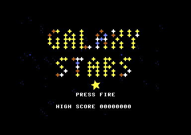
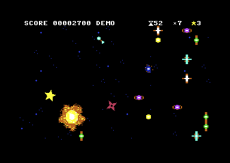
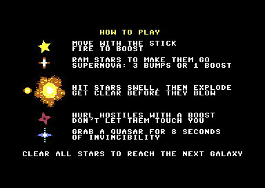
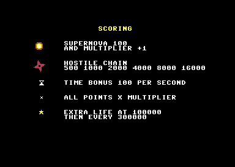

# Galaxy Stars

A single-screen action game for the **Commodore 64**, designed by Rev. Layle and written in [Prog8](https://github.com/irmen/prog8) by Claude (Anthropic's AI model), driven by a written spec and built in phases. It's the second game made this way, after [Smashy Smashy](https://github.com/revlayle/smashy-smashy).

You are a spinning yellow star. Slam into the stars of each galaxy until they go supernova, and get clear before they blow. Stars turn hostile and chase you; boost into them to hurl them away, where they explode and set off chain reactions. Clear every star to reach the next galaxy.

> [!NOTE]
> **All graphics and sound effects are AI-generated.** Every sprite, star and explosion was drawn by Claude as text art, and the SID effects were designed by Claude too. Each image is a small grid of characters in a plain text file, rebuilt automatically, so any of it is easy to redraw. See [Changing the graphics](#changing-the-graphics).

> **How was this made?** See [docs/development-story.md](docs/development-story.md) for what was specific to this game. The general method (spec, phase plan, one AI coding session per phase) is told in full in [Smashy Smashy's story](https://github.com/revlayle/smashy-smashy/blob/main/docs/development-story.md).

<p>
  
  
</p>
<p>
  
  
</p>

## Getting started

You need **Python 3.8+** and an internet connection. Everything else is downloaded into the project folder by a setup script; nothing is installed system-wide.

```
python tools/setup.py        # Java 21, Prog8 12.3.4, 64tass, VICE (Windows), C64 reference texts
build.cmd run                # Windows
./build.sh run               # Linux / macOS
```

The build converts the art, compiles `src/main.p8` to `build/main.prg`, and `run` starts it in VICE with the keyboard mapped to joystick port 2.

- **Windows** is fully tested.
- **Linux and macOS** need VICE and 64tass from your system: the setup script detects them, or tells you what to install (Linux: the VICE Flatpak `net.sf.VICE` and `build-essential` for 64tass; macOS: `brew install vice tass64`). The Linux/macOS path is written but not yet tested.

**Just want to play?** Download `galaxy-stars.prg` from the [latest release](https://github.com/revlayle/galaxy-stars/releases/latest) and open it in any C64 emulator (e.g. drag it onto VICE), or run it on a real PAL C64.

## Playing

| Input | Action |
|---|---|
| Joystick (8 directions) | Move |
| Fire | Boost: 2.5x speed for 1.5 s, then a short cooldown |
| Run/Stop | Pause |

Keyboard in VICE: arrow keys and left Ctrl (from `tools/vicerc`), or any gamepad set up as joystick 2.

- **Stars:** bump a star 3 times, or hit it once while boosting, and it swells for 2 seconds, then goes supernova. Its explosion sets off the stars around it, kills hostiles, and costs you a life if you're caught in it.
- **Hostile stars:** every few seconds a star flashes red and turns into a hostile that chases you (up to 6). Touching one costs a life, unless you're boosting: then it's hurled away and explodes where it lands, or flies off the screen.
- **Quasar:** a supernova sometimes leaves one behind (at most once a galaxy). Grab it for 8 seconds of invincibility at full speed.
- **Galaxies:** 60 seconds each, with no penalty when time runs out (just no bonus). Every galaxy has more stars and faster, more frequent hostiles, up to galaxy 21.
- **Scoring:** supernova 100 and multiplier +1 (up to x9; it drops back over time). Hostile kills in one chain: 500, 1000, 2000, 4000, 8000, 16000. Time bonus 100 per second left. Every score is multiplied by the multiplier. Extra life at 100,000, then every 300,000. You start with 3 lives.

The game is built for PAL machines (50 Hz). On NTSC it runs about 20% faster.

When idle, the title cycles through HOW TO PLAY, SCORING and a demo game played by a small AI pilot routine. Fire starts a game from any of them.

## Changing the graphics

All art lives in two text files: `assets/sprites.txt` (player, hostile, quasar, death effect, the title's flying stars) and `assets/tiles.txt` (the 8 star kinds, the swelling star, the 3 explosion frames, background specks and HUD icons). Each picture is a grid of characters, one per pixel:

```
sprite player_0                tile star_0 color 7
..........1.............       ..1111..
.........111............       ..1221..
........11111...........       ..1221..
...                            ...
```

- **Symbols:** `.` = transparent (or background), `1` = the sprite's or tile's own colour, `2` and `3` = the two shared colours (white and orange for the star tiles). The palette values are in `src/video.p8`.
- **Sizes:** sprites are hi-res 24 x 21 (the quasar is a 12 x 21 multicolour `msprite`); star tiles are multicolour, 8 double-width pixels x 16 rows; the explosion is one 3 x 3-tile entry.
- **Rebuilding:** edit the file, save, and rebuild (`build.cmd run` / `./build.sh run`). The converter (`tools/gfx.py`) turns the text into C64 graphics data and names each picture for the code, so redrawing needs no code changes. The comments at the top of each file explain the rest.
- **Sound effects** are small tables of SID settings at the top of `src/sound.p8` (waveform, envelope, start pitch, pitch slide, length), one column per effect.

## Repository map

| Path | What |
|---|---|
| `galaxy-star-basic-spec.txt` | Rev. Layle's original design notes |
| `docs/spec.md` | Technical spec: every gameplay rule, number, memory address and data format, with the decisions made along the way |
| `docs/phases.md` | The build plan, and each phase's notes: what was built, how it was tested, what was measured |
| `docs/title-attract.md` | Notes on the title, attract pages and demo, built after the phases; plus a plan for music |
| `docs/session-prompts.md` | The prompts used to start each coding session |
| `docs/development-story.md` | What was specific to making this game |
| `AGENTS.md` | Standing instructions for AI coding agents (any tool); `CLAUDE.md` imports it for Claude Code |
| `.claude/skills/` | Prog8 language and 6502 assembly guides (from the Prog8 project, GPL-3.0) |
| `docs/c64/` | C64 hardware references, downloaded by the setup script, not stored in git |
| `src/` | The game, 15 Prog8 modules (see below) |
| `assets/` | Sprites and tiles as editable text art |
| `tools/gfx.py` | Converts the text art into binary graphics and a Prog8 constants file |
| `tools/setup.py` | Downloads the toolchain and reference texts |
| `build.cmd`, `build.sh` | Build (and run) scripts for Windows and Linux/macOS |

Source modules:

| Module | Role |
|---|---|
| `main.p8` | Game flow (attract cycle, galaxies, game over) and the built-in self-test scenarios |
| `video.p8` | VIC-II setup (bank 3, multicolour chars, hi-res sprites), tile and HUD drawing, frame IRQ |
| `input.p8` | Joystick and keyboard matrix, edge detection, scripted input for tests, the demo pilot's stick |
| `player.p8` | Movement, boost, bounce, spin, death effect, respawn, invincibility |
| `stars.p8` | Galaxy layout, star hits, countdowns, supernovas, red warnings |
| `hostiles.p8` | Hostile stars: spawning, steering, contact, hurling |
| `explode.p8` | Explosion list, animation, drawing and hit checks |
| `score.p8` | BCD score (in hundreds), multiplier, chains, lives, timer, high score |
| `quasar.p8` | Quasar spawn and pickup |
| `title.p8`, `pages.p8` | Title screen with the star-built logo, and the HOW TO PLAY and SCORING pages |
| `demo.p8` | The AI pilot that plays the attract demo |
| `sound.p8` | Table-driven SID sound effects |
| `prof.p8` | Test-only frame-time profiler (CIA timer) |
| `gen_assets.p8` | Generated by `tools/gfx.py`, not edited by hand |

## Using a different AI agent

The project was built with Claude Code, but nothing in it requires Claude: `AGENTS.md` holds all agent instructions and is read by opencode, OpenAI Codex, Cursor, GitHub Copilot's agent and others; the Prog8 guides in `.claude/skills/` are plain Markdown; and the workflow (spec → phases → one session per phase → designer playtests → commit) lives entirely in `docs/`.

## Toolchain

`tools/setup.py` puts everything in `tools/` (ignored by git):
- Prog8 12.3.4, pinned. The game was built and tested with it, and works around one of its compiler bugs (see `AGENTS.md`).
- A portable JDK 21. Prog8 needs Java 17 or newer.
- 64tass 1.60 (or any 64tass 1.58+ already on the PATH).
- VICE 3.10 on Windows.
- A shallow clone of the Prog8 source at the same version, for its manual and library source.

## License

The game, tools and documentation in this repository are under the [MIT License](LICENSE), © 2026 Rev. Layle.

Exceptions and credits:
- The skills in `.claude/skills/` are from the [Prog8 project](https://github.com/irmen/prog8) and are GPL-3.0.
- Programs compiled with Prog8 are explicitly excluded from Prog8's GPL by its author, so the built game can be shared freely.
- The C64 reference texts are not included; the setup script downloads them from [mist64/c64ref](https://github.com/mist64/c64ref) and zimmers.net.
